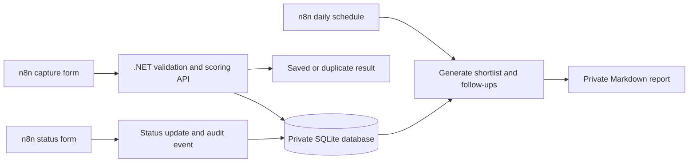

# Career Inbox

A personal job-search automation built for my own .NET/Azure career search. I capture job descriptions once, get an explainable shortlist, and track what I have actually applied for.

**Personal portfolio project, built with AI coding assistance. Not a client engagement.** This release uses deterministic rules, not an LLM. It does not scrape job boards, independently verify vacancies, send applications, or contact recruiters.

## Why this exists

My job search spans several boards. The same listing appears in multiple places, descriptions vary, and an accessible page may already be closed. Career Inbox gives me a private record, consistent matching rules, and explicit unknowns rather than a misleading hiring score.

## Working features

- n8n capture form with required fields and API-side validation.
- URL normalization: removes tracking parameters and fragments while retaining meaningful job query IDs.
- Database UNIQUE constraint and transactional insertion prevent duplicates, including concurrent retries.
- C# rules match .NET, Azure, SQL, frontend, APIs, automation, and deployment skills. Each score is a keyword match score, not a prediction of hiring success.
- Closed, Philippines-ineligible, and known below-minimum-rate opportunities are excluded from the shortlist. Unknown salary/status/eligibility is clearly flagged.
- Application status form with an audit trail; marking a job applied does not submit an application.
- Daily 08:00 Asia/Manila shortlist generation with manual follow-up reminders after seven days in applied status.
- Private SQLite data and reports; public source and synthetic tests only.
- Real HTTP integration tests and GitHub Actions CI.

## Architecture



## Run locally

Requirements: .NET 8 SDK, an existing n8n instance (validated against 2.42.7), and Python 3.12+ for tests or workflow regeneration. Use current patched runtime versions. No paid service or API key is needed.

```powershell
dotnet build src/CareerInbox -c Release
python -m unittest discover -s tests -v
powershell -NoProfile -ExecutionPolicy Bypass -File scripts/Start.ps1
```

On Windows, double-click **Start Career Inbox.cmd** after the initial setup. On other platforms, set `CAREER_INBOX_DATA` to a private persistent directory and run `dotnet src/CareerInbox/bin/Release/net8.0/CareerInbox.dll`.

Import each JSON in `workflows/` through n8n's workflow menu → Import from File, then Publish each workflow. The API must run on the same host as n8n; the shipped URLs are loopback addresses. If n8n runs in Docker, configure authenticated private networking before changing these URLs; this release is not designed for public API hosting.

| Purpose | Local address |
|---|---|
| Capture a job | http://localhost:5678/form/career-inbox-capture |
| Update an application | http://localhost:5678/form/career-inbox-status |
| Read the shortlist | http://127.0.0.1:5680/digest |
| Inspect all saved records | http://127.0.0.1:5680/jobs |
| Health check | http://127.0.0.1:5680/health |

Both the API and n8n must be running. A sleeping or powered-off computer cannot run the daily schedule; missed runs are not automatically replayed. Run the digest workflow manually after a missed day. The Windows launcher starts these services for this workspace but does not install an always-on Windows service.

## Everyday use

1. Find a listing on a job board; inspect its original page and copy its URL, title, company and description.
2. Open the capture form. Enter hourly compensation **only if it is in USD per hour**; leave it blank when unknown or quoted monthly. Do not silently convert currencies or units.
3. Select Philippines eligibility and vacancy status based on what you actually verified. Choose unknown/unverified when uncertain.
4. Submit. The result gives a saved ID or the existing ID for a duplicate. Capture does not overwrite original job details.
5. Review the shortlist and the source page. After applying yourself, use the status form to record `applied` and a note.

The score weights and minimum-rate configuration are explained in [docs/design.md](docs/design.md). For an honest project explanation and demo walkthrough, see [docs/portfolio-case-study.md](docs/portfolio-case-study.md).

## Tests

Seven integration tests run against a real, isolated API process and temporary SQLite database. They check invalid data, concurrent duplicate submissions, distinct job IDs, scoring/exclusions, status/audit/follow-ups, digest regeneration, and cross-origin protection. Synthetic data uses `example.com` and fictional companies. Tests never access the user's private database.

## Security and limitations

The service binds to 127.0.0.1 and rejects unexpected Host headers and browser-origin mutations. There is no API authentication: this is a single-user trusted-local-machine setup. Do not expose it through a tunnel, reverse proxy, LAN binding or public hosting without adding authentication, authorization, rate limits and HTTPS. n8n forms are likewise intended to remain local.

No job URLs are fetched by the service. No CV, email inbox, passwords or API tokens are needed. n8n can retain failed execution payloads; treat its database as private too. Stop the API before backing up `data/`. Stop n8n separately before backing up its database. Never publish databases, logs, real reports or execution exports.

The keyword matcher does not understand negation or distinguish mandatory from optional skills. Status is user-entered; a captured description is not proof a job is currently open. Multiple URLs for the same vacancy can still produce duplicates. Invalid inputs produce an API error; the form displays a generic failure message and n8n keeps the error for inspection. Planned improvements include authenticated hosting, richer field errors, company/title deduplication and optional evaluated AI extraction.
